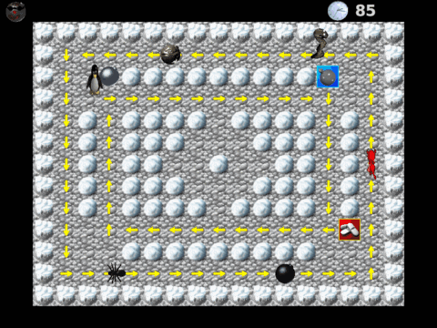
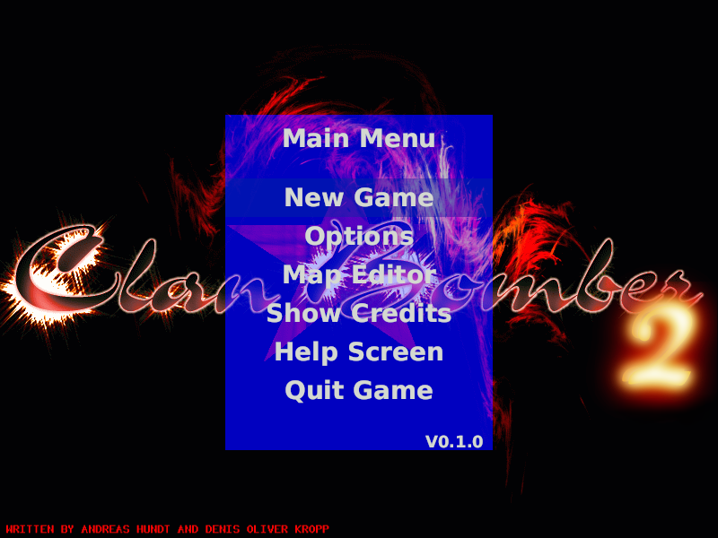
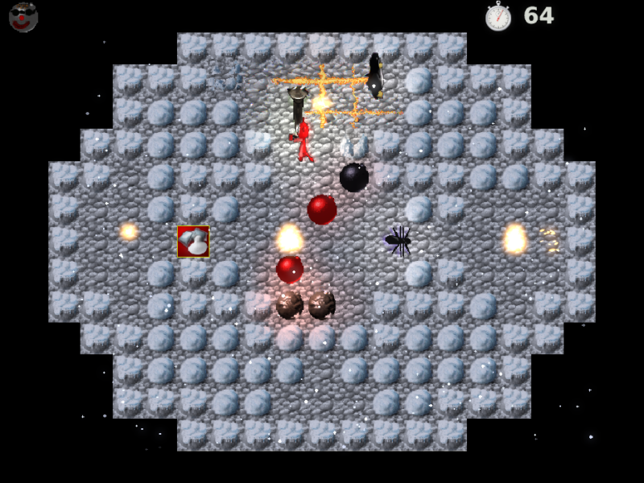
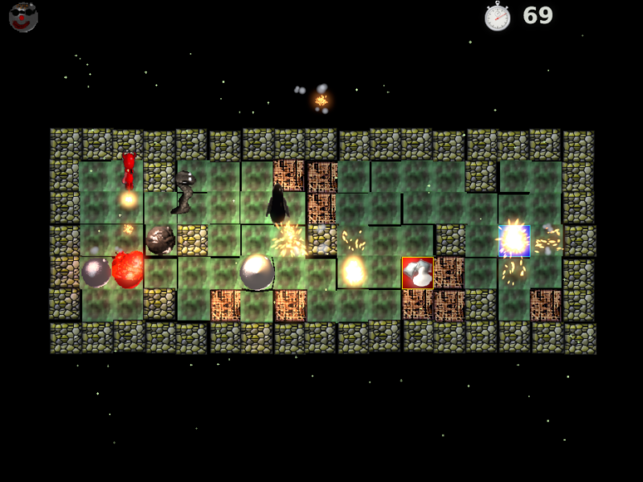
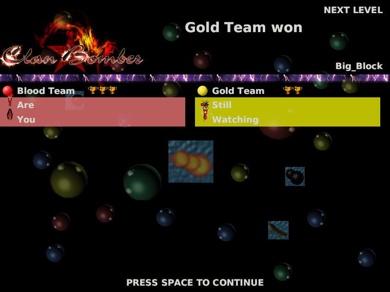
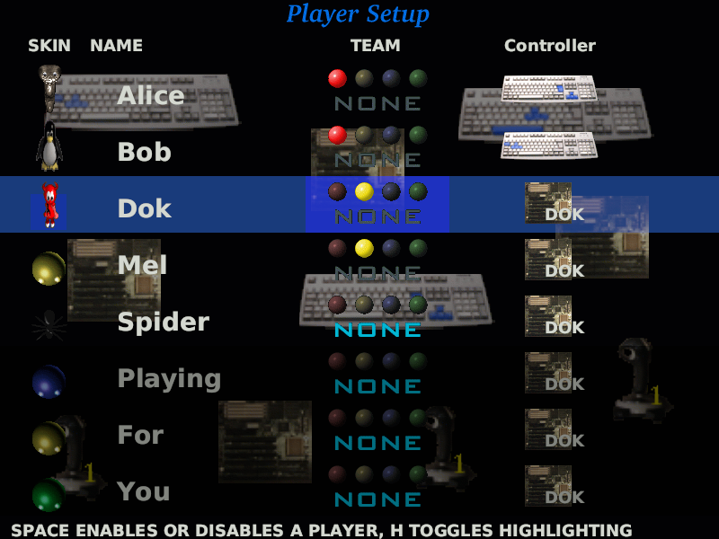
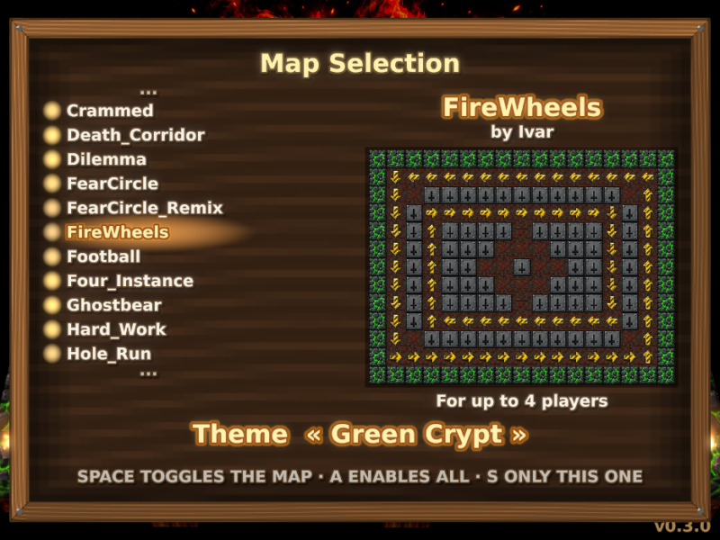
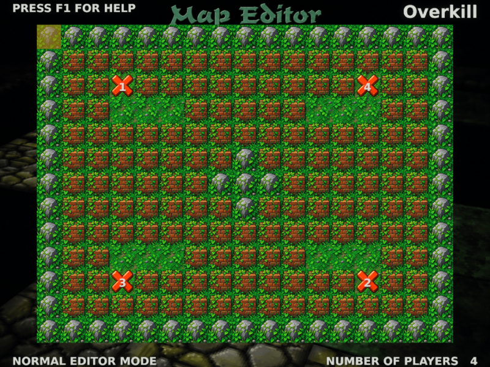
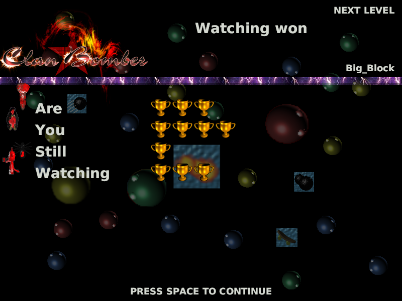

<div align="center">

# 💣 ClanBomber RS

### The classic ClanBomber 2 Bomberman, rewritten in **Rust** with **wgpu**.

Up to 8 players, AI opponents, gamepads, 33 maps, power-ups, diseases, ice, traps… and plenty of pixel blood.

[](https://github.com/oriaj-nocrala/clanbomber-rs/actions/workflows/ci.yml)
[](https://www.rust-lang.org)
[](https://wgpu.rs)
[](LICENSE)


[](https://github.com/oriaj-nocrala/clanbomber-rs/commits/main)
[](https://github.com/oriaj-nocrala/clanbomber-rs/stargazers)
[](https://github.com/oriaj-nocrala/clanbomber-rs/pulls)



<sub>Four AIs on <i>FireWheels</i>, with arrows pushing bombs around. Recorded by the game itself (<code>--screenshots</code>).</sub>

**🇬🇧 English** · 🇪🇸 Español: expand **“Leer en español”** at the bottom ↓

</div>

---

## ✨ What is this?

ClanBomber is a shared-screen Bomberman: mazes of boxes and walls, bombs that explode in a cross, power-ups that make
you stronger… or put you on a cocaine rush. This project is a **faithful Rust port** of the original game (the SDL
fork by [viti95](https://github.com/viti95/ClanBomber2) was the executable reference): same rules, same maps, same
graphics and sounds, but with a clean, well-tested simulation core and a modern **wgpu** renderer (Vulkan, Metal,
DX12). Tested on Linux; macOS and Windows should work but are untested.

<table>
<tr>
<td width="50%"></td>
<td width="50%"></td>
</tr>
<tr>
<td align="center"><sub>Main menu, on the original title screen</sub></td>
<td align="center"><sub>Ice arena: AIs, bombs, power-ups and cross-shaped fire</sub></td>
</tr>
<tr>
<td width="50%"></td>
<td width="50%"></td>
</tr>
<tr>
<td align="center"><sub>6 graphic themes — this one is “Jungle Arena”</sub></td>
<td align="center"><sub>Team scoreboard between rounds</sub></td>
</tr>
<tr>
<td width="50%"></td>
<td width="50%"></td>
</tr>
<tr>
<td align="center"><sub>8 seats: skin, name, team and controller</sub></td>
<td align="center"><sub>Map selection with live preview</sub></td>
</tr>
<tr>
<td width="50%"></td>
<td width="50%"></td>
</tr>
<tr>
<td align="center"><sub>Built-in map editor</sub></td>
<td align="center"><sub>Scoreboard with trophies</sub></td>
</tr>
</table>

## 🎮 Features

- **Up to 8 players**: keyboards (3 layouts), gamepads (stick or d-pad + A) and an **AI** that flees from fire,
  grabs power-ups, avoids diseases and blasts its way through boxes without suiciding.
- **Every power-up**: more bombs, more range, skateboards, **kick** (push bombs), **glove** (throw bombs through the
  air) and the diseases **Joint** (reversed controls), **Viagra** (non-stop bombs) and **Koks** (absurd speed), which
  spread by touch.
- **Tricky terrain**: ice that makes you slide, arrows that push bombs, traps that fire them over walls, holes you
  fall into.
- **Complete rounds**: flying entrance, round clock, *HURRY UP* warning and, when time runs out, an observer that
  eats the floor tile by tile. Trophy scoreboard and **team** mode.
- **33 maps** from the original, a **map editor**, a selector with preview and 6 themes.
- **Corpses** that crawl around and burst into chunks, screen shake, blood in the credits and a kids mode to switch
  it all off.
- **Sound and music**: the original effects plus the `bud.mod` tracker module (F2), rendered with libopenmpt.
- **Fully configurable** from the menu: starting and maximum power-ups, bomb timings, which items drop, points to
  win, round time…
- **Deterministic**: fixed-step simulation (60 Hz) and every random number comes from one seeded generator. Same
  seed, same match.

## ⌨️ Controls

| | Left / Right / Up / Down | Bomb |
|---|---|---|
| **Keyboard 1** | ← → ↑ ↓ | Enter |
| **Keyboard 2** | A D W S | Tab |
| **Keyboard 3** | J L I K | Space |
| **Gamepad** | Left stick or d-pad | A |

**Standing still on your own bomb and pressing bomb again** (with the glove) throws it. **Walking into a bomb** (with
the kick) pushes it.

| Key | Action |
|---|---|
| Esc | Leave the match / go up a menu level |
| Space | Continue from the scoreboard to the next round |
| P / F3 | Pause |
| F2 | Background music |

## 🚀 Build and play

You need [Rust](https://rustup.rs) (stable) and, for sound and gamepads, a few system libraries:

```bash
# Arch Linux
sudo pacman -S alsa-lib libopenmpt pkgconf systemd-libs
# Debian / Ubuntu
sudo apt install libasound2-dev libopenmpt-dev pkg-config libudev-dev
```

```bash
git clone https://github.com/oriaj-nocrala/clanbomber-rs.git
cd clanbomber-rs
cargo run --release -p cb-game
```

Or grab a prebuilt Linux build from the [Releases](https://github.com/oriaj-nocrala/clanbomber-rs/releases) page
(it only needs `libasound2`, `libopenmpt0`, `libudev1` and a Vulkan-capable GPU).

Your settings live in `~/.config/clanbomber-rs/config.txt` and your own maps in
`~/.local/share/clanbomber-rs/maps/`. Set `CB_ASSETS=/path/to/assets` to use a different assets folder.

### Taking screenshots

```bash
cargo run --release -p cb-game -- --screenshots docs/img
```

Walks through the game's screens, saves a PNG of each and builds a GIF of an AI match (needs ImageMagick). It renders
off-screen, so it never captures your desktop.

## 🧱 Architecture

```
crates/
├── core/     cb-core    Pure simulation: map, bombers, bombs, power-ups, AI, rounds… No graphics, no audio.
├── render/   cb-render  2D renderer on wgpu: quad batching, glyph-atlas text, PNG capture.
└── game/     cb-game    Window (winit), menus, drawing, audio, gamepads and the main loop.
```

The core knows nothing about windows or sound: it emits `GameEvent`s that the binary turns into audio, and the
renderer only reads the `World` state. That makes it testable without a GPU:

```bash
cargo test        # 130+ tests: rules, AI, rounds, teams, menus, gamepads…
```

Every gameplay rule cites, in a comment, the original source file it was ported from. CI runs formatting, Clippy
(warnings are errors), the test suite and a release build on every push.

## 🛣️ Roadmap

- [ ] GPU particles with a *compute shader* (explosions, smoke, blood).
- [ ] AI-upscaled sprites and 3D sprites.
- [ ] Online play with *rollback* (the simulation is already deterministic).
- [ ] Web build (wgpu → WebGPU / WASM).

## 📜 License and credits

Free software under the **GNU GPL v2 or later** (see [`LICENSE`](LICENSE)), like the original game.

**ClanBomber** is the work of **Andreas Hundt** and **Denis Oliver Kropp**, with the “mass” AI and many contributors
(see the original project's `AUTHORS`). The SDL version is by Rene Lopez and viti95. The **graphics, sounds, music and
maps** in this repository come from ClanBomber 2 and are distributed under the same terms. The *DejaVu Sans Bold*
typeface ships with its own license ([`assets/fonts/LICENSE.DEJAVU`](assets/fonts/LICENSE.DEJAVU)).

This is an independent, unofficial port. All the Rust code is new.

---

<details>
<summary><b>🇪🇸 Leer en español</b> — versión completa en español</summary>

### ✨ ¿Qué es?

ClanBomber es un Bomberman de pantalla compartida: laberintos de cajas y muros, bombas que explotan en cruz, extras
que te hacen más fuerte… o te ponen a tope de cocaína. Este proyecto es **un port fiel a Rust** del juego original
(el fork SDL de [viti95](https://github.com/viti95/ClanBomber2) fue la referencia ejecutable): mismas reglas, mismos
mapas, mismos gráficos y sonidos, pero con un núcleo de simulación limpio y testeado y un renderer moderno sobre
**wgpu**. Probado en Linux; macOS y Windows deberían funcionar, pero no se han probado.

Las capturas de arriba son las mismas: menú, partidas con distintos temas, marcadores, configuración de jugadores,
selección de mapas y editor.

### 🎮 Características

- **Hasta 8 jugadores**: teclados (3 esquemas), mandos (stick o cruceta + botón A) e **IA** que huye del fuego, recoge
  extras, evita las enfermedades y abre camino a bombazos sin suicidarse.
- **Todos los extras**: más bombas, más alcance, patines, **patada** (empuja bombas), **guante** (lanza bombas por el
  aire) y las enfermedades **Joint** (controles invertidos), **Viagra** (bombas sin parar) y **Koks** (velocidad
  absurda), que se contagian por contacto.
- **Terreno con trucos**: hielo que te hace resbalar, flechas que empujan bombas, trampas que las disparan por encima
  de los muros, huecos en los que caes.
- **Rondas completas**: entrada volando al mapa, reloj de ronda, aviso *HURRY UP* y, al acabarse el tiempo, un
  observador que se va comiendo el suelo casilla a casilla. Marcador con copas y modo por **equipos**.
- **33 mapas** del original, **editor de mapas** propio, selección con vista previa y 6 temas.
- **Cadáveres** que se arrastran y revientan en trozos, temblor de explosiones, sangre en los créditos y modo
  infantil para apagarlo todo.
- **Sonido y música**: efectos del original y el módulo `bud.mod` (F2) renderizado con libopenmpt.
- **Todo configurable** desde el menú: extras iniciales y máximos, tiempos de bomba, qué extras caen, puntos para
  ganar, tiempo de ronda…
- **Determinista**: simulación de paso fijo (60 Hz) y toda la aleatoriedad con un generador con semilla. Misma
  semilla, misma partida.

### ⌨️ Controles

| | Izquierda / Derecha / Arriba / Abajo | Bomba |
|---|---|---|
| **Teclado 1** | ← → ↑ ↓ | Enter |
| **Teclado 2** | A D W S | Tab |
| **Teclado 3** | J L I K | Espacio |
| **Mando** | Stick izquierdo o cruceta | A |

**Pulsar bomba otra vez sin moverte** (con guante) lanza la bomba. **Caminar contra una bomba** (con patada) la
empuja. Esc sale al menú, Espacio pasa del marcador a la siguiente ronda, P/F3 pausa y F2 activa la música.

### 🚀 Compilar y jugar

```bash
# Arch Linux
sudo pacman -S alsa-lib libopenmpt pkgconf systemd-libs
# Debian / Ubuntu
sudo apt install libasound2-dev libopenmpt-dev pkg-config libudev-dev

git clone https://github.com/oriaj-nocrala/clanbomber-rs.git
cd clanbomber-rs
cargo run --release -p cb-game
```

También hay compilaciones para Linux en la página de [Releases](https://github.com/oriaj-nocrala/clanbomber-rs/releases).
La configuración se guarda en `~/.config/clanbomber-rs/config.txt` y tus mapas en
`~/.local/share/clanbomber-rs/maps/`. Con `CB_ASSETS=/ruta/a/assets` se usa otra carpeta de recursos.

Para sacar las capturas: `cargo run --release -p cb-game -- --screenshots docs/img` (renderiza fuera de pantalla, no
captura tu escritorio).

### 🧱 Arquitectura

- `crates/core` (`cb-core`): simulación pura (mapa, bombers, bombas, extras, IA, rondas…), sin gráficos ni audio.
- `crates/render` (`cb-render`): renderer 2D sobre wgpu con lotes de quads, texto con atlas de glifos y captura a PNG.
- `crates/game` (`cb-game`): ventana (winit), menús, dibujo, audio, mandos y el bucle de juego.

El núcleo emite `GameEvent`s que el binario convierte en sonido, así que se prueba sin GPU (`cargo test`, más de 130
tests). Cada regla cita el archivo del original del que se portó. La integración continua pasa formato, Clippy (los
avisos son errores), tests y compilación release en cada push.

### 🛣️ Siguientes pasos

Partículas por *compute shader*, reescalado de sprites con IA y sprites 3D, juego en línea con *rollback* (la
simulación ya es determinista) y versión web (WebGPU / WASM).

### 📜 Licencia y créditos

Software libre bajo la **GNU GPL v2 o posterior** ([`LICENSE`](LICENSE)), igual que el juego original.
**ClanBomber** es obra de **Andreas Hundt** y **Denis Oliver Kropp**, con la IA «mass» y muchos colaboradores; la
versión SDL es de Rene Lopez y viti95. Los **gráficos, sonidos, música y mapas** vienen de ClanBomber 2 y se
distribuyen bajo sus mismos términos; la tipografía *DejaVu Sans Bold* lleva su propia licencia. Port independiente y
no oficial: todo el código Rust es nuevo.

</details>
